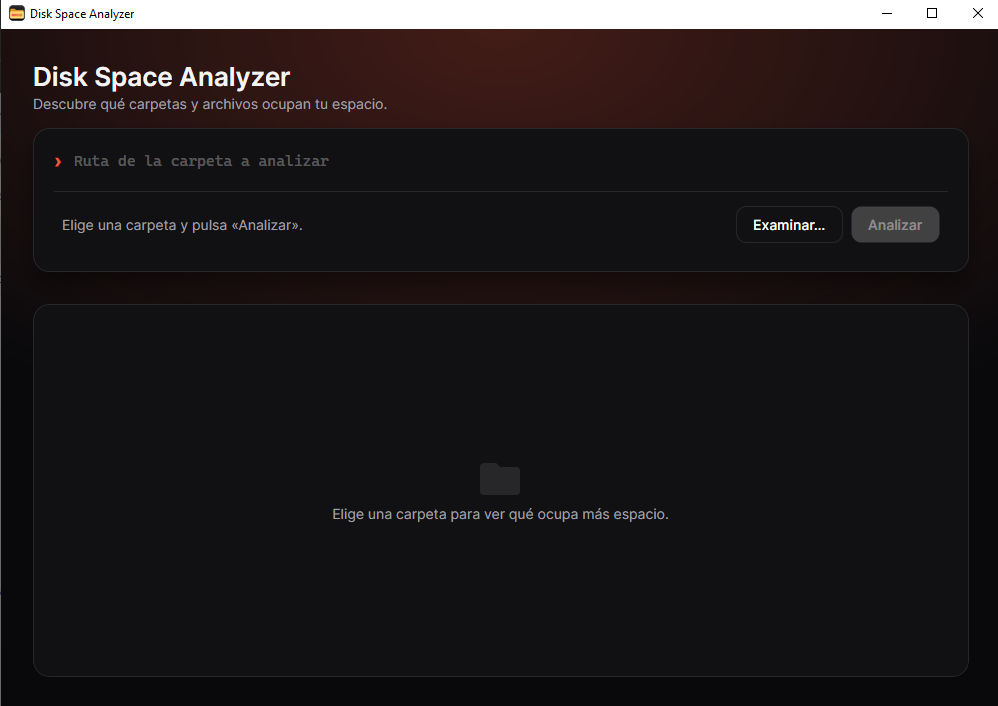
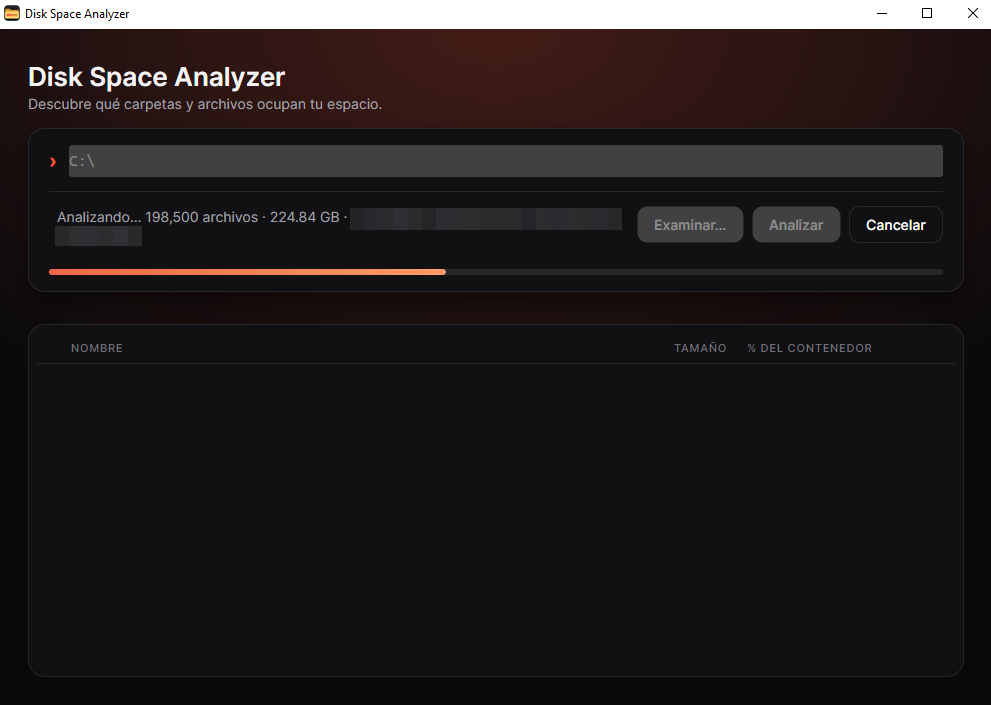
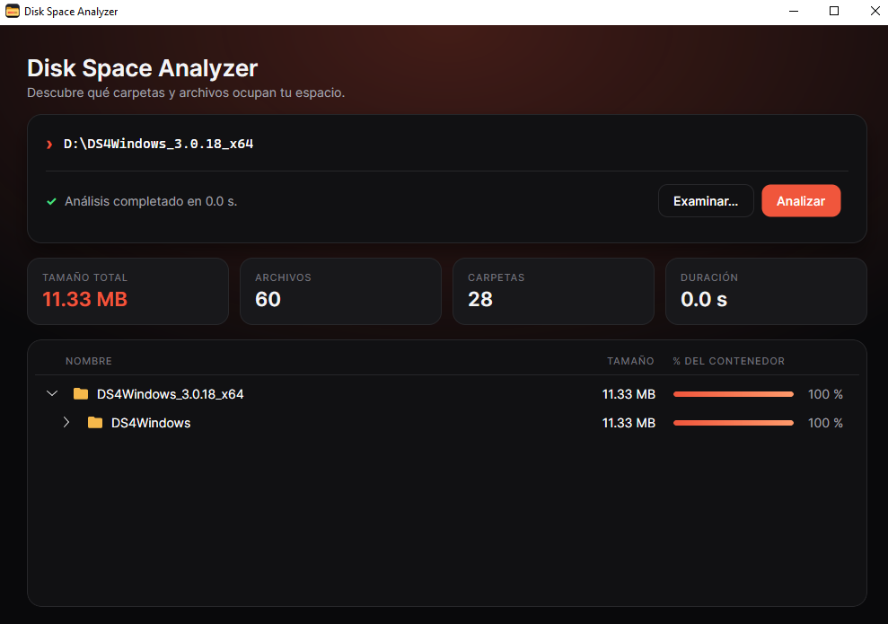
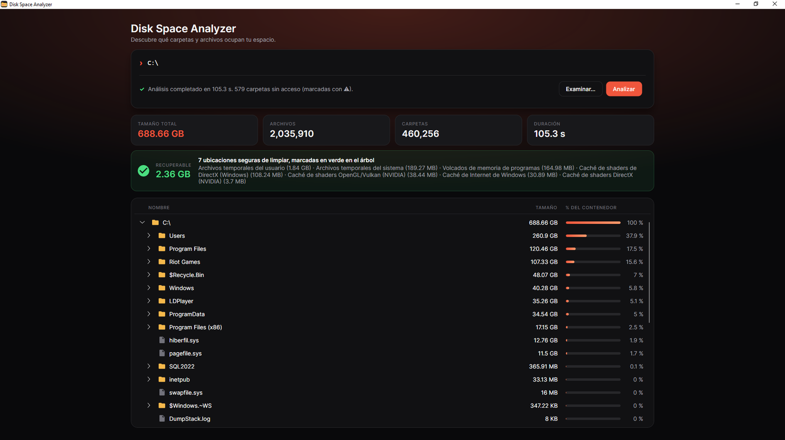

<p align="center">
  
  
  
  
</p>

<p align="center">
  <a href="#qué-es">Qué es</a> ·
  <a href="#descargar">Descargar</a> ·
  <a href="#cómo-levantarlo">Cómo levantarlo</a> ·
  <a href="#cómo-funciona">Cómo funciona</a> ·
  <a href="#ubicaciones-seguras-de-limpiar">Ubicaciones seguras</a> ·
  <a href="#a-tener-en-cuenta">A tener en cuenta</a>
</p>

<table>
  <tr>
    <th align="center">Inicio</th>
    <th align="center">Analizando</th>
    <th align="center">Resultado</th>
  </tr>
  <tr>
    <td></td>
    <td></td>
    <td></td>
  </tr>
</table>

<p align="center">
  
</p>

---

## Qué es

Cuando el disco se llena no es fácil saber qué lo ocupa: el Explorador de Windows no muestra el tamaño de las carpetas y calcularlo a mano es lento.

**Disk Space Analyzer** analiza la carpeta o unidad que elijas y te muestra, en un árbol, cuánto pesa cada carpeta y archivo, ordenados de mayor a menor y con el porcentaje que ocupa cada uno. Así ves de un vistazo dónde está el espacio y decides qué limpiar o mover.

Es una herramienta de **solo lectura**: nunca modifica ni borra nada de tu disco.

## Descargar

Si no programas y solo quieres usarlo, no necesitas instalar nada:

1. Entra en la página de [**Releases**](https://github.com/KireSql/disk-space-analyzer/releases) y abre la versión más reciente.
2. En *Assets*, descarga `DiskSpaceAnalyzer-vX.Y.Z-win-x64.zip`.
3. Descomprime el `.zip` y abre **`DiskSpaceAnalyzer.exe`**. Es un único archivo: no necesita instalación ni tener .NET.

Funciona en **Windows de 64 bits**. En Linux y macOS aún no hay versión descargable.

> **Aviso de Windows:** como el programa no está firmado digitalmente, al abrirlo por primera vez puede salir *"Windows protegió su PC"*. Pulsa **Más información → Ejecutar de todas formas**. Si quieres comprobar que el archivo no se alteró, junto al `.zip` hay un `.sha256` con su huella para compararla.

## Cómo levantarlo

Si prefieres ejecutarlo desde el código, necesitas el [SDK de .NET 10](https://dotnet.microsoft.com/download).

```bash
git clone https://github.com/KireSql/disk-space-analyzer.git
cd disk-space-analyzer
dotnet run --project src/DiskSpaceAnalyzer.Desktop
```

Se abre la ventana de la aplicación. Para ejecutar las pruebas automáticas:

```bash
dotnet test
```

## Cómo funciona

1. **Elige una carpeta**: escribe la ruta o pulsa **Examinar…**. Puede ser una carpeta cualquiera o una unidad completa.
2. **Pulsa Analizar**. Mientras trabaja ves cuántos archivos lleva y puedes **cancelar** cuando quieras. La ventana no se congela.
3. **Lee el resultado**:
   - Cuatro tarjetas resumen: tamaño total, archivos, carpetas y duración.
   - Un árbol que se expande carpeta a carpeta, con el tamaño de cada elemento y una barra con el porcentaje que ocupa dentro de su carpeta.
4. **Clic derecho** sobre una carpeta (o archivo) para abrirla en el explorador de archivos del sistema.
5. **Fíjate en las marcas**:
   - **⚠** junto a una carpeta: no se pudo leer todo su contenido (por ejemplo, carpetas del sistema o de otros usuarios). El análisis sigue con el resto, pero el total puede quedar algo por debajo del real.
   - **Verde y LIMPIABLE**: ubicación que suele ser segura de limpiar. Se explica en la siguiente sección.

La ventana se adapta a distintos tamaños: en pantallas estrechas se simplifica para que todo siga siendo legible.

## Ubicaciones seguras de limpiar

Algunas carpetas solo guardan archivos que Windows o los programas vuelven a crear cuando hacen falta: temporales, cachés, informes de errores. La aplicación las **señala** para que sepas dónde hay espacio recuperable:

- La carpeta se tiñe de verde y lleva la etiqueta **LIMPIABLE**. Al pasar el ratón por encima explica qué contiene y qué pasa si se borra.
- Una tarjeta **RECUPERABLE** suma el espacio de todas las que encuentre.

**Solo se señalan, nunca se borran.** Que una carpeta aparezca marcada se decide por **dónde está**, no por lo que contiene, así que revisa su contenido antes de borrar nada (por ejemplo, con clic derecho → *Abrir en el explorador de archivos*).

**Qué marca hoy en Windows:** temporales del usuario (`%LOCALAPPDATA%\Temp`) y del sistema (`%SystemRoot%\Temp`), cachés de shaders de NVIDIA (`DXCache`, `GLCache`) y de DirectX (`D3DSCache`), volcados de errores (`CrashDumps`) y la caché de Internet de Windows (`INetCache`).

### Personalizar la lista

Las reglas están en [`windows.json`](src/DiskSpaceAnalyzer.Infrastructure/CleanupRules/windows.json). Puedes quitar o añadir las tuyas; cada una tiene este aspecto:

```json
{
  "id": "nvidia-dxcache",
  "name": "Caché de shaders DirectX (NVIDIA)",
  "path": "%LOCALAPPDATA%\\NVIDIA\\DXCache",
  "description": "Caché de shaders que el controlador regenera solo. La primera vez que abras cada juego puede cargar algo más lento."
}
```

La ruta admite variables de entorno como `%LOCALAPPDATA%`. Para otro sistema operativo se añade un archivo con el mismo formato (`linux.json`, `macos.json`); mientras no exista, en ese sistema no se marca nada.

## A tener en cuenta

- **Solo se ha probado en Windows 10.** El programa está pensado para funcionar también en Linux y macOS, pero todavía no se ha probado allí.
- **El tamaño es el del archivo**, no el espacio realmente ocupado en disco (que puede variar por clústeres, compresión o archivos de OneDrive que solo están en la nube).
- **Los enlaces simbólicos y puntos de unión no se siguen**, para no contar dos veces el mismo contenido ni caer en bucles.
- **Carpetas con cientos de miles de archivos directos** pueden tardar en desplegarse en el árbol.

## Próximos pasos posibles

- Analizar varias carpetas en paralelo para ir más rápido.
- Mostrar el resultado también como gráfico (treemap).
- Exportar el resultado a CSV.
- Probar y ajustar en Linux y macOS.

<details>
<summary><b>Para quien quiera tocar el código</b></summary>

<br>

El proyecto está dividido en capas; cada una depende solo de las de más abajo:

```
src/
├── DiskSpaceAnalyzer.Core/            Lógica del análisis y modelo de datos (no depende de nada)
├── DiskSpaceAnalyzer.Infrastructure/  Lectura real del disco y reglas de limpieza (windows.json)
└── DiskSpaceAnalyzer.Desktop/         Ventana de Avalonia (MVVM)
tests/
└── DiskSpaceAnalyzer.Tests/           Pruebas automáticas (xUnit)
assets/                                Icono de la aplicación y capturas de este README
```

El icono se genera a partir de los SVG de `assets/icon/` con `python assets/icon/build-icon.py` (las instrucciones están al inicio del script).

**Publicar una versión:** al subir una etiqueta que empiece por `v`, el flujo de [`.github/workflows/release.yml`](.github/workflows/release.yml) ejecuta las pruebas, genera el `.exe` autocontenido para Windows y crea la Release con el `.zip` y su `.sha256`. Si las pruebas fallan no se publica nada.

```bash
git tag v1.0.0
git push origin v1.0.0
```

Una etiqueta con guion (`v1.0.0-beta`) se publica como versión preliminar. El flujo también se puede lanzar a mano desde la pestaña *Actions*: compila y prueba y deja el `.zip` como artefacto, pero no crea ninguna Release.

</details>
